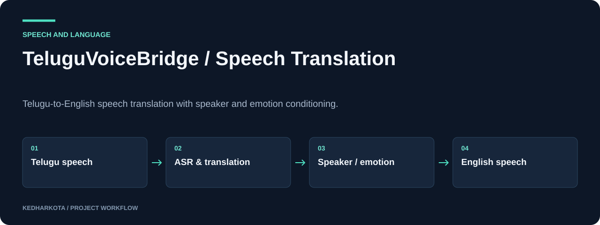

# TeluguVoiceBridge · Speech Translation

Telugu-to-English speech translation with speaker and emotion conditioning.

**Python · PyTorch · Whisper · NLLB · ECAPA-TDNN · XTTS-v2**

[Overview](#overview) · [Getting started](#getting-started) · [Repository guide](#repository-guide) · [Reproducibility](docs/REPRODUCIBILITY.md)



*Explanatory workflow diagram based on the committed project materials.*

## Overview

An experimental speech-to-speech translation pipeline designed to translate Telugu speech into English while retaining aspects of speaker identity and emotion. The notebooks cover data preparation, individual model adaptation, TTS rebuilding, and an integrated Gradio demo.

## What this project includes

- Whisper-based Telugu ASR and NLLB translation fallback.
- ECAPA-TDNN speaker embeddings and Wav2Vec2 emotion features.
- XTTS-v2 speech synthesis with integration and evaluation routines.
- LoRA/quantization experiments and sequential training for limited GPU memory.

## Getting started

Read `PROJECT_DOCUMENTATION.md`, then run the environment notebook and data pipeline before training component notebooks. Use a compatible CUDA/PyTorch environment and consult each notebook's installation cells for its model-specific requirements.

Open the notebooks through Jupyter and run them in order. The integration notebook launches the Gradio interface after the models and configuration files are available.

### Required inputs and current constraints

Training audio, manifests, generated YAML files under `configs/`, and trained checkpoints are not included in the visible root tree. Notebook 08 reads those configuration files immediately. The four root `.py` files are empty placeholders, so the notebooks are the implementation entry point. Model downloads may require their own access and license acceptance. Use recordings with the speaker's permission.

## Repository guide

| File | Purpose |
| --- | --- |
| [01_environment_setup.ipynb](01_environment_setup.ipynb) | Environment and configuration setup. |
| [02_data_pipeline.ipynb](02_data_pipeline.ipynb) | Audio preparation and training manifests. |
| [03_whisper_asr_finetuning.ipynb](03_whisper_asr_finetuning.ipynb) | ASR adaptation. |
| [04_speaker_encoder_finetuning.ipynb](04_speaker_encoder_finetuning.ipynb) | Speaker encoder experiments. |
| [05_translation_finetuning.ipynb](05_translation_finetuning.ipynb) | Translation adaptation. |
| [06_emotion_detector.ipynb](06_emotion_detector.ipynb) | Emotion feature modeling. |
| [07_tts_finetuning.ipynb](07_tts_finetuning.ipynb) | Initial TTS experiments. |
| [07b_tts_rebuild.ipynb](07b_tts_rebuild.ipynb) | TTS rebuild/fixes. |
| [08_pipeline_integration_demo.ipynb](08_pipeline_integration_demo.ipynb) | Integrated pipeline and Gradio demo. |
| [ARCHITECTURE.md](ARCHITECTURE.md) | Architecture details. |
| [PROJECT_DOCUMENTATION.md](PROJECT_DOCUMENTATION.md) | Training methodology, evaluation plan, and dependencies. |

## Results and project status

The documentation lists target metrics and an evaluation framework for ASR, translation, speaker similarity, emotion, and speech quality. Target values are not verified achieved results. Reproducible pipeline metrics, checkpoints, and listening samples are not committed as standalone artifacts in the root tree.

## Next steps

- Publish a tested environment, configuration examples, and checkpoint provenance.
- Add consented before/after audio samples and a completed evaluation table.

## Documentation maintenance

Local documentation links and image headers are checked on pull requests and relevant pushes by the [documentation workflow](.github/workflows/docs.yml). Run the same check locally:

```bash
python tools/check_docs.py
```

See the [reproducibility guide](docs/REPRODUCIBILITY.md) for evidence, missing artifacts, and visual-source notes. The check validates documentation files; it does not train models or certify application behavior.

---

[More projects by kedharkota](https://github.com/kedharkota?tab=repositories)
